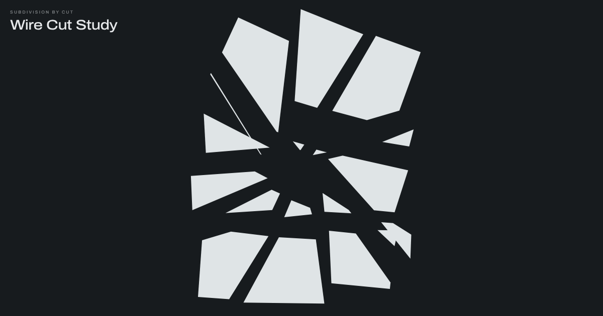

# Wire Cut Study

[](https://app.netlify.com/projects/splendid-churros-27f7e2/deploys)

**A drawing made only by cutting.** Drag a wire across a square plate and the pieces come
loose and slowly drift away.

**Live:** [cheesewireisyourfriend.com](https://cheesewireisyourfriend.com)



## The idea

Nothing on screen is ever drawn directly. There is one square, and every mark you see is a
gap left behind by a straight cut. Keep cutting and the plate breaks into smaller and
smaller pieces that wander off. Press Gather and they all ease back to where they started,
so the original square reassembles with every cut showing as a hairline.

It is a small, calm toy rather than a game: no score, no goal, no sign-up.

## How to play

| Action | Mouse or touch | Key |
| --- | --- | --- |
| Cut | Drag from bare ground across the plate | |
| Move a piece | Drag the piece | |
| Nudge loose pieces | Tap bare ground | |
| Cut tool | | C |
| Hold tool (move only, no cutting) | | H |
| Drift, Fall, Still | | 1, 2, 3 |
| Random colours | | X |
| Gather the pieces home | | G |
| New plate | | N |
| Close the panel | | Escape |

The pill at the bottom of the screen opens the options: colour palettes (including a custom
picker and a random "Chance" pair), the wire tool and the motion style.

## Privacy

- **No cookies, no tracking, no analytics, no sign-up.**
- **Nothing loads from any other website.** Fonts are hosted alongside the page rather than
  fetched from Google Fonts, so no visitor's IP address is shared with a third party.
- A Content Security Policy (in `netlify.toml`) enforces this, so a stray third-party
  script or font would be blocked rather than quietly loaded.

## Accessibility

- Follows the device's light or dark setting by default.
- Respects "reduce motion": the interface stops fading and Gather snaps instead of
  animating.
- Every control can be reached and used from the keyboard.

## Project structure

```
site/               Everything that is published, and nothing else
  index.html        The whole toy: markup, styles and script in one file
  og.png            1200x630 link preview image
  fonts/            Self-hosted Archivo and DM Mono (woff2) with their licences
netlify.toml        Hosting config: publish folder, security and cache headers
LICENSE             MIT licence for the code
README.md           This file
```

No build step, no package manager, no framework, no dependencies.

## How it works

Notes for anyone changing the code, including the decisions that are easy to undo by
accident.

- **Pieces.** Each piece is a polygon stored around its own centre, with a position,
  angle, velocity and spin, drawn to one full-screen canvas. Pieces deliberately pass
  through each other. There is no collision detection, which keeps the motion calm.
- **Cutting.** A stroke on bare ground draws the wire, and on release `slice()` makes
  exactly one straight cut from press point to release point. A piece is only cut if the
  stroke genuinely touched it: the line crosses one of its edges, or an end of the stroke
  sits inside it (`strokeTouches`).
- **Do not pad the stroke.** The stroke is extended by 2px and no more. An earlier version
  padded strokes by 30% plus 10px to make short cuts easier, and it cut neighbouring
  pieces the user never touched. Keep the 2px.
- **Dragging.** Pressing on a piece picks it up, whichever tool is active. The wire only
  starts on bare ground. Hold is the safety tool: dragging still works, but bare ground
  does nothing.
- **Gather depends on "home".** Every piece remembers where it sat in the uncut square
  (`home` and `homeAng`). When a piece is cut, each half works out its own home from its
  parent's. Gather eases every piece back home, so the square reassembles with the cuts
  showing as hairlines. **Any change to the cutting logic must keep homes correct**, or
  Gather quietly stops lining up.
- **Motion.** Drift, Fall and Still are three exclusive states. Pieces settle back to
  their own slow drift rather than stopping, so the plate is never completely still.
- **Colour.** Everything is drawn from three CSS variables: `--ground`, `--form` and
  `--wire`. `applyPalette()` sets them, then picks light or dark overlay colours from the
  ground's brightness so the controls stay readable on any palette. To add a palette, add
  an entry to the `palettes` array. Nothing else needs touching.
- **Controls.** One pill at the foot opens the options sheet. All on-screen controls fade
  to 16% after 2.6 seconds without input and return on any input.

## Working on it

- **Keep it self-contained.** No CDNs, hosted fonts or analytics. The Content Security
  Policy blocks anything loaded from another site, so it fails loudly in production. If
  the inline script ever moves to its own file, remove `'unsafe-inline'` from
  `script-src` in `netlify.toml`.
- **Anything visitors need goes in `site/`.** Everything else stays outside it, so it is
  never published.
- **Plain ES5-style JavaScript.** No modules, no transpiling, no build step.

## Running it locally

Serve the `site` folder with any static server, for example:

    python3 -m http.server 8000 --directory site

Then visit http://localhost:8000

Opening `site/index.html` directly also works, though some browsers block local font files
that way.

## Deploying

Hosted on [Netlify](https://www.netlify.com), deploying from the `main` branch on GitHub.

- **Every push to `main` goes live** within a minute or so.
- Pull requests get their own preview link from Netlify, so changes can be checked before
  they are merged.
- `netlify.toml` is the source of truth for hosting settings and overrides anything set in
  the Netlify dashboard.

## Ideas for later

1. A way to change the shape of the plate.
2. A way to keep an image: export the current plate as a PNG.
3. Reproducible random palettes, so a colour pair you like can be recovered.
4. A freehand cutting mode alongside the straight wire.
5. Real collisions between pieces. This would change the character of the piece
   considerably, so it would be a redesign rather than a fix.

## Credits

- [Archivo](https://github.com/Omnibus-Type/Archivo) by Omnibus-Type, and
  [DM Mono](https://github.com/googlefonts/dm-mono) by Colophon Foundry, both under the
  SIL Open Font License 1.1. Licence texts are in `site/fonts/`.

## Licence

The code is released under the [MIT Licence](LICENSE), so you are free to use, change and
share it as long as the copyright notice comes along. The fonts keep their own SIL Open
Font License, which is included in `site/fonts/`.
